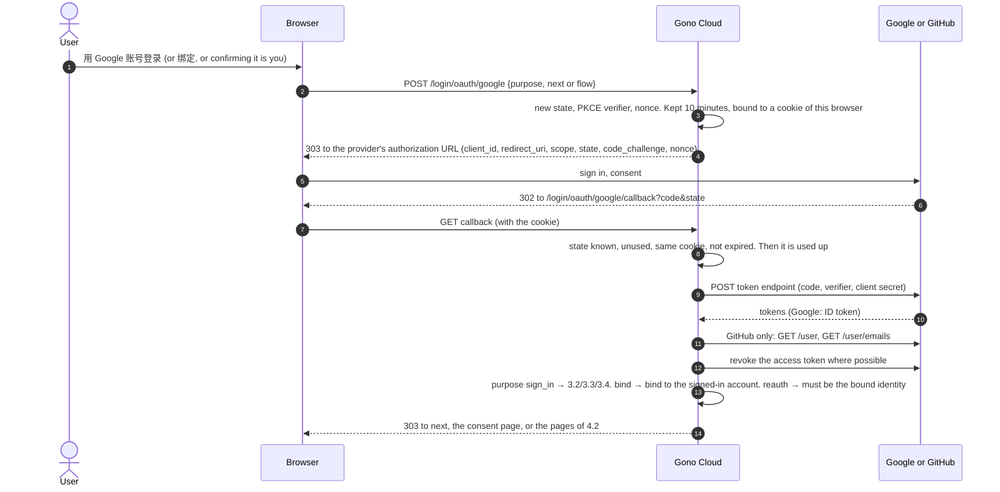
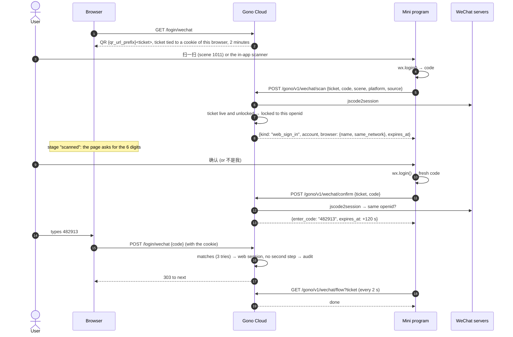

# Third-party sign-in: WeChat, Google and GitHub (design)

> 2026-11-23. **Status: design, nothing built.** No server code changes with this document; the
> work is listed in section 10.
>
> Read for it:
> - [docs/wechat-miniprogram.md](../docs/wechat-miniprogram.md) and the WeChat and Email
>   sections of [docs/deployment.md](../docs/deployment.md);
> - sections 4, 10 and 13 of [docs/connect-protocol.md](../docs/connect-protocol.md) (cited as
>   **P n**);
> - `crates/server/core/src/wechat.rs`, `crates/server/bin/src/site.rs`,
>   `crates/server/bin/src/login_flow.rs`, `crates/server/bin/src/admin/mod.rs` and the `users`
>   table of `crates/server/core/migrations/sqlite/0001_initial.sql`.
>
> [wechat-miniprogram-design.md](wechat-miniprogram-design.md) (cited as **MP n**) is the mini
> program's side; this document is the model it fits into.

## 0. In short

- **Three providers, one model.** Signing in with WeChat (by scanning a QR code with the mini
  program), with Google and with GitHub are one feature: **third-party sign-in**. An account can
  have at most one identity of each provider, next to an optional web password. An identity
  belongs to one account. Today's `wechat_identities` becomes the general `external_identities`,
  and WeChat keeps what only it has: the AppID as the realm, the unionid, and the mini program's
  sessions and tickets.
- **Where it shows.** Every sign-in page offers the configured providers next to the password
  form. That covers `/login`, the Login Flow v2 page (Nextcloud clients and device registration,
  P 4.2) and `/manage/login`. The account page gets one panel, 登录方式, where the password and
  each provider are set, bound and unbound.
- **What a third-party sign-in does.**
  - **A bound identity** signs in, and two-step verification is not asked.
  - **An identity that is not bound, whose provider-verified email equals an account's
    verified email**, is bound to that account automatically. It signs in, and a notice goes to
    the address.
  - **Any other unbound identity** may be bound by signing in with the password. It may also
    create an account, when the operator allows sign-up for that provider. Sign-up is off by
    default.
  - Accounts created this way start with no service, like every account.
- **WeChat on the web** is a QR code on the sign-in page, scanned and confirmed in the mini
  program. The phone then shows **6 digits that are always typed into the browser**, so a
  forwarded or phished QR code does not sign in someone else's browser.
- **Accounts without a web password** exist from now on. They set one on the account page after
  confirming with a fresh third-party sign-in. They can also delete themselves, with a 7-day
  cooling-off period.
- **Configuration** lives in `config.toml`, one table per provider; each secret sits in a file of
  its own, as for `[wechat]` and `[smtp]`.

## 1. Decisions recorded (user, 2026-11-23)

| Question | Decision |
|---|---|
| The model | WeChat scan, Google and GitHub are one kind of sign-in. One account, several identities; one entry to bind and unbind; the three entries on the sign-in pages |
| Creating accounts on a first third-party sign-in | A switch per provider (`allow_signup`), **off by default**. Off: an unbound identity can only be bound to an existing account |
| Services of accounts created this way | **None**, for every provider, the mini program included. This replaces MP's earlier "mini program sign-ups start with 远程直连 on". "New accounts have no service" now holds for every account |
| An identity whose verified email matches an account's verified email | **Bound automatically** |
| Two-step verification after a third-party sign-in | **Not asked**, for all three providers |
| The resulting risk: whoever controls an account's mailbox can sign in to it, even with TOTP, through a Google or GitHub account with that address | **Accepted.** A notice mail goes out on each automatic binding |
| `/manage` sign-in | **The same three entries** as the other sign-in pages; only admin accounts get in |
| Setting a password on an account without one | On the account page, after confirming with a third-party sign-in of the last 5 minutes |
| Where the OAuth apps are configured | `config.toml`: `[oauth.google]`, `[oauth.github]`, with `client_secret_file` |
| Scopes | Identity, email and name: Google `openid email profile`; GitHub `user:email` |
| WeChat scan sign-in on the web | **Always** a 6-digit code from the phone, typed into the browser |
| Product names in this public repository | None. The remote-desktop product that shares the mini program is named only outside it |

## 2. Today

- **Accounts** have a web login password (`users.password_hash`, Argon2id, `NOT NULL`), an
  optional verified email (`users.email`, proven with a code), optional TOTP, and five service
  switches, all off for a new account.
- **Sign-in pages:**
  - `/login` takes a password, then `/login/two-step` asks for the TOTP code when the account has
    one;
  - the Login Flow v2 page (`/login/v2/flow/<token>`) has its own password form and then the
    consent page;
  - `/manage/login` takes the password of admin accounts.

  None of them needs JavaScript.
- **WeChat** binds through the account page only: a QR code made with the web password, scanned
  by the mini program, gives the mini program a session of its own (`mp_sessions`). Nothing
  signs a browser in with WeChat. The reserved link `{qr_url_prefix}<ticket>` was kept for a
  sign-in like that.
- **Actions that ask for the web password again** on the account page: showing the WeChat QR
  code, unbinding WeChat, adding or replacing the email address. Revoking devices needs a
  session past the second step (P 10).

## 3. The model

### 3.1 Providers

| | WeChat | Google | GitHub |
|---|---|---|---|
| Key | `wechat` | `google` | `github` |
| Web sign-in | QR on the sign-in page, confirmed in the mini program, 6 digits typed into the browser (5.3) | OpenID Connect, authorization code with PKCE (5.1) | OAuth 2.0, authorization code with `state`, and PKCE where GitHub accepts it (5.1) |
| Subject | openid | `sub` of the ID token | the numeric user `id`, never `login`: logins can be renamed and reused |
| Realm | the AppID (`wechat.app_id`) | `https://accounts.google.com` | `github.com` |
| Email for automatic binding | none | `email`, when `email_verified` is true | the verified addresses of `GET /user/emails`, primary first |
| Label on the account page | 微信 (nothing of the openid) | the email | `@login`, refreshed at each sign-in |
| Name offered at sign-up | 新用户 | `name` | `name`, else `login` |
| Specific | unionid; mini program sessions, bind tickets | — | — |
| Scopes | none: `wx.login` | `openid email profile` | `user:email` (public profile data needs none) |
| The server connects to | `api.weixin.qq.com` | `oauth2.googleapis.com` | `github.com`, `api.github.com` |

### 3.2 Rules

- **An identity** is `(provider, realm, subject)`. It belongs to one account at most.
- **An account** has at most one identity per provider and realm: one WeChat, one Google, one
  GitHub. To change one, unbind it first. Binding a second Google account to the same account is
  not offered.
- **Ways in.** A web password, any bound identity, or both. An account always keeps at least one.
  Unbinding the last identity of an account without a password is refused (`last_sign_in`): it
  must set a password or bind another provider first. An administrator can always set a password
  (`/manage`, CLI).
- **What an identity gives.** A web session, the same as a password sign-in, and two-step
  verification is not asked (decided). Through that session it gives everything the session
  gives: the consent pages of Login Flow v2 and of device registration, app passwords, and the
  account page. WeChat adds the mini program's own sessions (MP 5.2).
- **The admin UI** takes the same three entries, and only accounts with the admin flag get an
  admin session (decided). Section 6 says what follows from it.
- **Tokens of providers are not kept.** The server reads the identity, the email and the name,
  then revokes the access token where the provider allows it and drops it. There are no refresh
  tokens and no calls on the user's behalf.

### 3.3 Automatic binding by email

When a Google or GitHub sign-in finds no identity, the server binds it to an account and signs
in, without asking, when every one of these holds:

- the provider reports the address as verified;
- it equals `users.email` of an account, which that account proved with a code (both lower-case);
- that account is enabled, is not waiting for its deletion, and has no identity of this provider
  yet.

Then:
- it records `identity.bound` with `how: "email"`;
- it mails the address. The mail names the provider and the label, says how to unbind on the
  account page, and asks the owner to secure the mailbox if they did not do it. The language is
  the page's, and it carries no link that signs anyone in.

When the account already has an identity of this provider, nothing is bound, and the sign-in
goes on as for any unbound identity (3.4). The page says nothing about the address having an
account: only an automatic binding reveals it, and only to whoever controls the address.

The server's own rule for an address stays: an address belongs to one account, and Gono Cloud
verifies it itself. A provider's address is never written into `users.email`. A user who wants
password resets by mail adds the address on the account page, with a code, as today.

### 3.4 Unbound identities

A sign-in that finds no identity and binds nothing leaves a **pending identity**: the provider,
realm and subject, label, email, and name. It lives 10 minutes and is bound to the browser by
a cookie, or to the mini program by a signup token, as today's `wechat_signup_tokens` is. It can
become:

- **a binding**: the user signs in with the password of an existing account. That sign-in asks
  for two-step verification as usual, because it is a password sign-in. A confirmation page then
  names both sides, "把 Google 账号 a@gmail.com 绑定到 alice？", before anything is bound;
- **a new account**, when the provider's `allow_signup` is on (section 4.5);
- **nothing**: it expires.

### 3.5 Confirming it is you (re-authentication)

Every action that asks for the web password today takes, as an alternative, a fresh sign-in with
a bound identity:

- showing the WeChat bind QR code and unbinding WeChat;
- adding or replacing the email address;
- binding and unbinding Google or GitHub;
- **setting a password on an account without one** (decided);
- requesting the account's deletion.

How it works:

- **The confirmation lasts 5 minutes** for this browser session, then the action asks again.
- **Google and GitHub:** a round trip to the provider with purpose `reauth` (5.1), which must
  return the identity bound to this account. It proves that the browser holds a live session of
  that identity. It does not make the provider ask for its password again.
- **WeChat:** the scan of 5.3 with purpose `reauth`, 6 digits included.
- **Accounts with a password** may use either.

The account page's revocation of devices needs "a session past the second step" (P 10). A
third-party session counts as one, because no second step is asked after it (decided).

## 4. Pages

Sketches are low fidelity, phone width, in the style of MP 4.2: `┃` is the page's edge, `[ … ]`
a button, `‹ … ›` a link. The pages work without JavaScript, as today's do; with it, the WeChat
page polls instead of reloading.

### 4.1 Sign-in pages

`/login`, the Login Flow v2 page and `/manage/login` share the form:

```
┃ Gono Cloud
┃━━━━━━━━━━━━━━━━━━━━━━━━━━━━━━━
┃ 登录
┃
┃ 用户名或邮箱
┃ [                         ]
┃ 密码
┃ [                         ]
┃ [           登录           ]
┃                   ‹忘记密码？›
┃
┃ ───────── 其他方式 ─────────
┃ [         微信扫码         ]
┃ [   用 Google 账号登录     ]
┃ [   用 GitHub 账号登录     ]
```

- Only configured providers appear. Without any, the page is today's.
- The buttons use each provider's name in plain text, and Google's and GitHub's own button rules
  for their marks if their logos are shown. The WeChat entry is ours: the mini program's rule of
  no WeChat marks on sign-in pages (MP 4.2) is about the mini program's pages. The web page shows
  the word 微信 without the logo all the same.
- **The Login Flow v2 page** keeps the flow: the provider buttons carry the flow inside the
  server-side state (5.1), never in the provider's URL. After the sign-in the user is back on the
  consent page, which names the client or the device as today.
- **`/manage/login`** shows the same entries. A third-party sign-in of an account that is not an
  admin ends with the page's usual refusal and no session.

### 4.2 After Google or GitHub

| Outcome | Page |
|---|---|
| A bound identity, enabled account | Signed in, on to `next` |
| Bound automatically (3.3) | Signed in, and a one-time notice on the next page: 已把 Google 账号 a@gmail.com 关联到你的账号，以后可以用它登录。 |
| Unbound, nothing matched | The page below |
| The account is disabled, or waits for deletion | 这个账号现在不能登录。 The deletion case links to the restore page (4.6) |
| The user cancelled at the provider | Back on the sign-in page: 已取消。 |
| The provider failed or is unreachable | 暂时无法使用 Google 登录，请稍后再试或用密码登录。 |

```
┃ 这个 Google 账号还没有绑定
┃━━━━━━━━━━━━━━━━━━━━━━━━━━━━━━━
┃ a@gmail.com
┃
┃ 已经有账号？用户名和密码登录后，
┃ 可以把它绑定到你的账号。
┃ [     用密码登录并绑定     ]
┃
┃ [         新建账号         ]   (allow_signup only)
┃ 新账号的服务都由管理员开通。
┃
┃ ‹取消›
```

### 4.3 WeChat on the sign-in page

`GET /login/wechat` (and the same below `/manage` and on the Login Flow v2 page) shows a QR code
for this browser and follows the sign-in through three stages:

```
┃ 微信扫码登录
┃━━━━━━━━━━━━━━━━━━━━━━━━━━━━━━━
┃   ┌───────────────┐
┃   │    QR CODE    │
┃   │               │
┃   └───────────────┘
┃ 用手机微信「扫一扫」扫这个二维码，
┃ 在小程序里确认。
┃ 二维码会自动更新。
┃
┃ ‹用密码登录›
```

```
┃ ✓ 已扫码
┃━━━━━━━━━━━━━━━━━━━━━━━━━━━━━━━
┃ 请在手机上确认，然后在这里输入
┃ 手机上显示的 6 位数字：
┃
┃ [ _ _ _ _ _ _ ]
┃ [           登录           ]
┃
┃ 数字 2 分钟内有效，可以试 3 次。
┃ ‹不是我扫的，重新开始›
```

- **The QR code** carries `{qr_url_prefix}<ticket>`, the link MP 5.1 routes to the confirm page.
  A ticket lives 2 minutes. The page shows a new one before it runs out, until the user leaves.
  The ticket is tied to this browser by a cookie, so only this browser can finish the sign-in.
- **Stages:** waiting; scanned (a WeChat locked the ticket; the page asks for the code); signed in
  (on to `next`); ended (手机上取消了这次登录 / 数字输错 3 次 / 超时了, each with 重新开始).
- **Without JavaScript** the page reloads itself every 3 seconds while it waits, and stops
  reloading once it asks for the code. With JavaScript it polls the status endpoint every
  2 seconds instead.
- **The code field** accepts 6 digits, 3 tries per code. A wrong try counts against the browser's
  address like a failed sign-in.

The phone's side is MP 4.14 "Confirm web sign-in".

### 4.4 The account page: 登录方式

One panel on the overview, replacing today's WeChat panel. Email and two-step verification keep
their own panels:

```
┃ 登录方式
┃━━━━━━━━━━━━━━━━━━━━━━━━━━━━━━━
┃ 密码 · 已设置               ‹修改›
┃ ───────────────────────────
┃ 微信 · 2026-11-20 起绑定    ‹解除›
┃ ───────────────────────────
┃ Google · a@gmail.com
┃ 2026-11-22 起绑定           ‹解除›
┃ ───────────────────────────
┃ GitHub · 未绑定              ‹绑定›
┃
┃ 用这些方式登录时不需要两步验证。
```

- An account without a password shows 密码 · 未设置 ‹设置›. Setting it goes through 3.5, then
  the usual new-password form.
- **‹绑定›:**
  - Google and GitHub confirm (3.5), then go to the provider with purpose `bind`;
  - WeChat confirms, then shows today's QR code (`{qr_url_prefix}bind/<ticket>`).
- **‹解除›** confirms (3.5) and names the effect. For WeChat: 小程序会在所有手机上退出. It is refused
  for the last way in (3.2): 这是你唯一的登录方式。请先设置密码或绑定另一种方式。
- Providers the server does not offer are left out. WeChat shows 本服务器没有提供微信小程序, as
  today, when `[wechat]` is off.
- The sentence about two-step verification is there because the user chose to skip it after
  third-party sign-ins. It shows only when the account has TOTP.

### 4.5 Sign-up

Shown after an unbound sign-in when the provider's `allow_signup` is on. For WeChat it happens in
the mini program (MP 4.14).

```
┃ 新建账号
┃━━━━━━━━━━━━━━━━━━━━━━━━━━━━━━━
┃ 用 Google 账号 a@gmail.com 新建
┃
┃ 用户名
┃ [ gg7k2m9q4p              ]
┃ 登录第一台设备或应用后就不能再改。
┃ 显示名称
┃ [ Alice Example           ]
┃
┃ 新账号的服务都由管理员开通，开通
┃ 前只能使用账户页。
┃ ☐ 我已阅读并同意《用户协议》
┃ [         新建账号         ]
```

- **The username** is generated: a provider prefix (`wx`, `gg`, `gh`) and 8 random lower-case
  letters and digits, never a retired name (P 9.1). It can be changed here and later, until the
  account has an app password or has registered a device (MP S16). Pairing statements name the
  account by its username (P 8.3, 8.4).
- **The display name** comes from the provider's name.
- **The terms box** shows only when the operator configured terms (`[sign_in] terms_url`); a
  self-hosted server may have none.
- **After it:** signed in, on the account page, with no service. The account has no web
  password, `created_via` names the provider, and audit records `account.created` and
  `identity.bound` with `how: "signup"`.

### 4.6 Deleting an account without a password

On the account page of an account without a web password (and in the mini program, MP 4.14):
注销账号, after 3.5 and typing the username.

- **The account is disabled at once:** sessions end, devices are refused. Their app passwords
  stay.
- **7-day cooling-off period.** Signing in with a bound identity during it leads to one page only:
  账号将于 … 注销 [撤销注销]. Undoing it enables the account again.
- **After 7 days** the server deletes the account, its files and its devices, as an
  administrator's deletion would.

An account with a password is deleted by an administrator, as today.

### 4.7 The admin UI

- **The account page** lists each identity: provider, label, since, last used, and 解除 for each.
  The last way in is protected as on the account page, unless the administrator also sets a
  password. It also shows 没有网页密码, `created_via` (自助：微信 / Google / GitHub) and a pending
  deletion, with 撤销注销 and 立即删除.
- **The list of accounts** can filter self-service accounts. Administrators get no notice of new
  ones (MP 1).
- **The CLI:** `gono-cloud user identities <user>`, `gono-cloud user unlink <user> <provider>`.

## 5. Flows

### 5.1 Google and GitHub (OAuth)



- **`purpose`:** `sign_in` (from a sign-in page, with `next` or the Login Flow v2 token, or the
  admin UI); `bind` and `reauth` (from the account page, for the signed-in account).
- **Sign-in pages without JavaScript** start with a form `POST`. The state never leaves the server
  except as the opaque `state` parameter; `next` and the flow token stay inside it.
- **Google:** the discovery document's endpoints, `response_type=code`, `scope=openid email
  profile`, PKCE `S256`, `nonce`, and `prompt=select_account`. The ID token comes from the token
  endpoint over TLS, so its issuer can be trusted from TLS (OpenID Connect Core 3.1.3.7); the
  server still checks `iss`, `aud` (the client ID), `exp` and `nonce`. It reads `sub`, `email`,
  `email_verified` and `name`, then revokes the token.
- **GitHub:** an OAuth app, `scope=user:email`, `state`, and PKCE if GitHub's endpoint accepts it
  (check when implementing). The token request asks for JSON. `GET /user` gives `id`, `login` and
  `name`; `GET /user/emails` gives `verified` addresses. Then
  `DELETE /applications/{client_id}/token` revokes the token.
- **Redirect URIs** are fixed: `{base_url}/login/oauth/{provider}/callback`, and `config check`
  prints them for the provider's console. `base_url` must be HTTPS.
- **Failures** (a wrong or reused state, a refused code, a token that does not check out) count as
  failed sign-ins of the client address, and the page says only 登录没有完成，请重试。

### 5.2 Binding and unbinding on the account page

- **Google, GitHub:** 3.5, then 5.1 with `bind`. The identity must not belong to another account
  (`account_exists`: 这个 Google 账号已经绑定了别的账号). The account must not have one of this
  provider (the button is not offered then). It records `identity.bound` with
  `how: "account_page"`.
- **WeChat:** 3.5, then today's QR code, bound by the mini program (MP 5.3).
- **Unbinding:** 3.5, the last-way-in check, then `identity.unbound`. For WeChat it also ends the
  mini program's sessions, as today.

### 5.3 WeChat sign-in on the web



- **The mini program's calls are shared with the remote-desktop product's device confirmation:**
  `scan`, `confirm`, `deny` and `flow` under `/gono/v1/wechat/`, from that product's plan. `kind`
  tells the mini program which page to show (`web_sign_in`, `reauth`, `device`). The link is the
  one reserved in docs/wechat-miniprogram.md, `{qr_url_prefix}<ticket>`.
- **Checks on `scan` and `confirm`:** the scene rule and the phone rule of `bind` (1011, 1047 or
  the in-app scanner; `ios`, `android`, `ohos`).
- **An unbound WeChat** gets `account: null`. The mini program then says this WeChat has no
  account and how to bind it. When `[wechat] allow_signup` is on, it offers 新建账号 (MP 4.14),
  after which the sign-in goes on with the new account.
- **A disabled account,** or one waiting for deletion: `scan` refuses with `account_disabled` or
  `deletion_pending`.
- **The 6 digits are always asked** (decided). The browser shows the field only once the ticket
  is locked. The digits live 120 seconds and allow 3 tries. `deny` or 3 wrong tries end the
  ticket, and the browser starts over.
- **`/manage`** uses the same flow and admits admin accounts only. Purpose `reauth` uses it from
  the account page, and the identity must be the one bound to the account.

### 5.4 Setting a password

账户页 → 登录方式 → 密码 · 未设置 ‹设置› → 3.5 with any bound identity → the new password twice → saved.
The account's other sessions stay. Audit `password.set`. With a bound email the user can use
"忘记密码？" as well, which sets the first password the same way a reset does.

## 6. Security

- **Login CSRF and replay.** `state` is random, single use, 10 minutes, bound to a cookie of the
  browser that started (`__Host-`, `HttpOnly`, `SameSite=Lax` so that the provider's redirect
  carries it). A callback in another browser does nothing. PKCE ties the code to the server's
  verifier; Google's `nonce` ties the ID token to the state.
- **Redirects.** The provider's redirect URI is fixed. `next` is checked as today
  (`site::after_sign_in`: local paths only).
- **Automatic binding.** Whoever controls an account's mailbox can bind a Google or GitHub
  account with that address, and sign in without TOTP. The user accepted it (section 1). What
  remains against it:
  - the notice mail;
  - `identity.bound` with `how: "email"` in the audit log;
  - only addresses the account itself verified with a code count.

  Today a mailbox alone can reset the password, but not get past TOTP. After this change it can.
- **No TOTP after a third-party sign-in** (decided). The second step is then the provider's own:
  Google's or GitHub's two-step settings, or the phone for WeChat. An account's TOTP still guards
  password sign-ins.
- **The admin UI** takes third-party sign-ins (decided). With automatic binding, control of an
  admin's mailbox therefore gives the admin UI. Operators who want an admin account kept out of
  it remove its email address. A server option to keep the admin UI on passwords only can come
  later. This is named in docs/deployment.md.
- **QR sign-in phishing.** A QR code forwarded from someone else's browser, or relayed by a phishing
  page, signs in nothing without the 6 digits typed into that browser. The phone shows them with
  不要告诉任何人，只输入到你自己正在登录的浏览器里. Other safeguards:
  - the scene and phone rules;
  - 2-minute tickets;
  - the ticket is bound to the browser that showed it.

  What remains: someone who talks the victim into reading the digits out.
- **Enumeration.** Pages after a third-party sign-in never say whether an address or a username
  has an account, except through an automatic binding (3.3). A password sign-in of an account
  without a password fails exactly like a wrong password, after the same Argon2 work.
- **Limits.** The sign-in pages' failed-attempt limiter counts OAuth failures, wrong 6-digit codes
  and refused scans. Sign-up per provider: a daily cap per client network and one for the server.
- **Secrets and logs.** Client secrets live in files (`client_secret_file`, mode 0640). Codes,
  states, verifiers, tokens, ID tokens, subjects and provider addresses are never logged; lines
  name the account. Only digests of tickets and of the 6 digits are stored.
- **Reachability.** Google is not reachable from mainland China: neither from a server there nor
  from users' browsers. GitHub often is slow. A server in mainland China offers WeChat only. The
  docs say so.

## 7. Configuration

```toml
[oauth.google]
enabled = true
client_id = "1234567890-abc.apps.googleusercontent.com"
client_secret_file = "/etc/gono-cloud/google-secret"
allow_signup = false

[oauth.github]
enabled = true
client_id = "Ov23liAbCdEf"
client_secret_file = "/etc/gono-cloud/github-secret"
allow_signup = false

[wechat]                      # today's keys, plus:
web_sign_in = true            # the QR code on the sign-in pages (needs the mini program's confirm page)
allow_signup = false          # 新建账号 in the mini program

[sign_in]
terms_url = ""                # optional; shown on the sign-up pages
```

- `config check` validates each table. It names the secret files and whether they exist, never
  their content, and prints the redirect URIs to register. It warns when `base_url` is not HTTPS,
  and when `files_ui` is off: the sign-in pages are part of the web file UI.
- Changing a client ID keeps the bindings: Google's `sub` and GitHub's `id` do not depend on the
  app. Changing `wechat.app_id` starts WeChat over, as today.

## 8. Storage

Schema changes go into `0001_initial.sql`, SQLite and MySQL, with no compatibility with older
databases. That is the project's rule until the first release with this schema.

- **`users`:**
  - `password_hash` becomes nullable: `NULL` is "no web password";
  - `created_via` (`admin`, `cli`, `wechat`, `google`, `github`; the first admin is `cli`);
  - `deleting_at` (`NULL`, or when the deletion happens).
- **`external_identities`** replaces `wechat_identities`:
  - columns: `id`, `user_id` (cascade), `provider`, `realm`, `subject`, `unionid` (WeChat only,
    nullable), `label`, `created_at`, `last_seen_at`;
  - `UNIQUE (provider, realm, subject)` and `UNIQUE (user_id, provider, realm)`;
  - a `CHECK` that `unionid` is `NULL` unless the provider is `wechat`.
- **`pending_identities`** replaces `wechat_signup_tokens`: the digest of a signup token (mini
  program) or of a browser cookie (web), the identity's columns, `email`, `email_verified`,
  `name`, `created_at`, `expires_at` (10 minutes).
- **`mp_sessions`** references `external_identities (id)` with a cascade, instead of
  `(user_id, app_id, openid)`. Unbinding then ends the sessions by itself.
- **`wechat_bind_tickets`** stays as it is.
- **`wechat_sign_in_tickets`** (new):
  - the digest of the ticket and of the browser's cookie;
  - `purpose` (`sign_in`, `admin`, `reauth`) and the flow or `next`;
  - the locked openid, the stage, the digest of the 6 digits and the tries left;
  - the browser's address (for `same_network`), `created_at`, `expires_at`.

  The remote-desktop product's device confirmation keeps its own columns on `login_flows`, in
  its plan.
- **OAuth states** stay in memory, as the shown bind tickets do: 10 minutes, a cap on the number,
  lost on restart, after which the user starts again.
- **Audit:** `identity.bound` and `identity.unbound` with `provider` and `how` (`account_page`,
  `mini_program`, `email`, `signup`, `admin`, `cli`). They replace `wechat.bound` and
  `wechat.unbound`. Also `account.created` with `via`, `password.set`,
  `account.deletion_requested`, `account.deletion_cancelled`. The sign-in record gains `method`
  (`password`, `wechat`, `google`, `github`).

## 9. The mini program

What changes on its side is in MP; in short:

- **Binding** stays as built: the account page's QR code. The bound row becomes an
  `external_identities` row of provider `wechat`.
- **A new page, Confirm web sign-in** (MP 4.14). The router sends `{qr_url_prefix}<ticket>` to
  it; `scan` says which `kind` the ticket is.
- **Sign-up in the mini program** sits behind `[wechat] allow_signup`, off by default. The account
  starts with no service (section 1).
- **Its accounts without a password** reach the web pages by scanning the sign-in page. There they
  can set a password, add an email address and enrol TOTP. MP's earlier limits for such accounts
  (no consent page, no TOTP) fall away.

## 10. Work (server)

- [ ] **T1 The model.**
  - `external_identities`, `pending_identities`, `mp_sessions` on identities, the `users` columns
    (section 8);
  - `wechat.rs` and the mini program's API move onto them, with the same answers;
  - the 登录方式 panel with WeChat in it;
  - the last-way-in rule, 3.5's confirmation with a password, the audit kinds;
  - the identities in the admin UI and the CLI;
  - password sign-in of an account without a password fails as a wrong password does.
- [ ] **T2 Google and GitHub.**
  - `[oauth.*]`, and 5.1 with `sign_in`, `bind` and `reauth`;
  - automatic binding and its mail (3.3);
  - the unbound page and binding after a password sign-in (3.4);
  - the buttons on `/login`, the Login Flow v2 page and `/manage/login`;
  - setting a password (5.4);
  - docs/deployment.md "Google and GitHub sign-in", with the redirect URIs, the scopes, the
    security notes of section 6, and reachability.
- [ ] **T3 WeChat on the web.**
  - `wechat_sign_in_tickets` and `/login/wechat` (also under `/manage` and on the Login Flow v2
    page);
  - `scan`, `confirm`, `deny`, `flow` with `kind`;
  - the 6 digits;
  - 3.5 by WeChat;
  - docs/wechat-miniprogram.md for the new calls. It needs the mini program's confirm page
    (MP phase 3).
- [ ] **T4 Sign-up and deletion.**
  - `allow_signup` per provider, the web sign-up page (4.5), the mini program's `signup` (MP S13);
  - generated usernames and renaming (MP S16);
  - deletion with the cooling-off period for accounts without a password (4.6, MP S15);
  - `created_via` in `/manage`, with its filter.

T1 comes first. T2 and T3 can follow in either order. T4 needs T2 or T3: an account without a
password needs a way to sign in on the web.

## 11. Open questions

- **Admin UI on passwords only:** whether to offer a server option for it later (section 6). The
  user chose the same entries as the other sign-in pages; the option would be an addition, not a
  change of that decision.
- **GitHub and PKCE:** check that GitHub's authorization endpoint takes `code_challenge` when T2
  is built. `state` and the client secret protect the flow without it.
