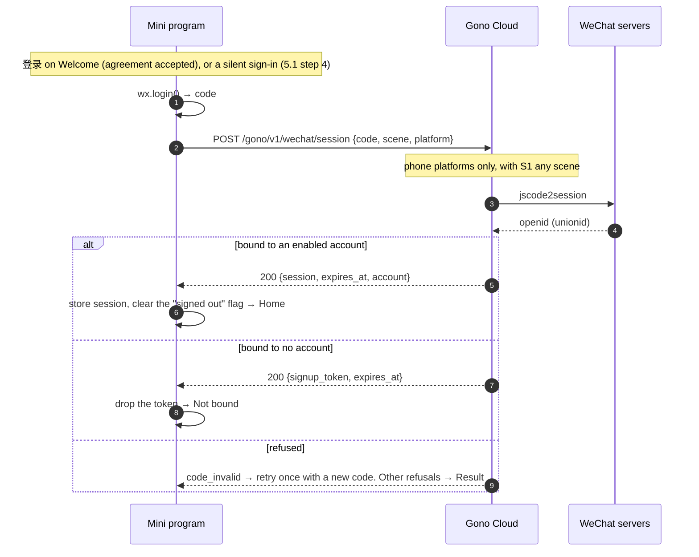
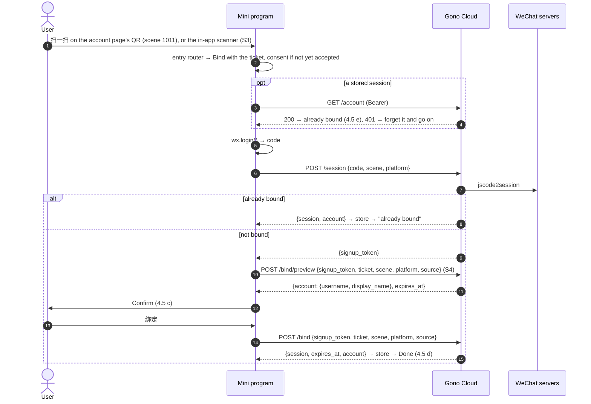
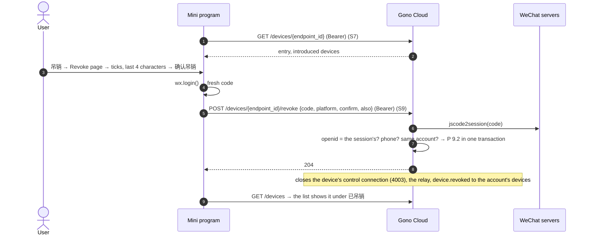

# WeChat mini program: features and screens (design)

> 2026-11-23. **Status (2026-11-24): server work partly built.** The server side of phase 1
> (S1–S4), of phase 3's web sign-in (TP T1 in `b6e6dc6`, TP T3 in `f0b7361`) and of phase 4
> (S13–S16, TP T4 in `38c1b4b`) is built; phase 2 (S5–S11), S12 and the device confirmation of
> phase 3 are not. The mini program itself lives in its own repository (section 0), not here.
> Section 9 lists the server changes and ticks the built ones; the questions still open for the
> user are in section 10.
>
> Read for it: [docs/wechat-miniprogram.md](../docs/wechat-miniprogram.md) (the API the server has
> today), `crates/server/bin/src/wechat/`, `crates/server/core/src/wechat.rs`,
> `crates/server/core/src/services.rs`, `crates/server/bin/src/service_view.rs`, the WeChat and
> Email sections of [docs/deployment.md](../docs/deployment.md), sections 4, 6, 9 and 10 of
> [docs/connect-protocol.md](../docs/connect-protocol.md) (cited as **P n**), and the plan of the
> remote-desktop product that shares the mini program, "WeChat mini program: QR sign-in and
> verification", kept in that product's own repository (cited as **RD n**). Where this document
> and RD differ on what Gono Cloud does, this document wins for Gono Cloud; RD stays the source
> for the remote-desktop product's sign-in confirmation.
>
> [third-party-sign-in-design.md](third-party-sign-in-design.md) (cited as **TP n**) puts WeChat
> next to Google and GitHub sign-in: the identity model, the web sign-in by scanning, and the
> rules for sign-up that this document follows. Where they differ, TP wins.

## 0. In short

- **One mini program, shared with a remote-desktop product.** It has one AppID, the one in
  `wechat.app_id`, and one account system, Gono Cloud's. Its pages for the account, the services
  and the devices belong to no single product. The remote-desktop product adds the confirmation
  of a computer's sign-in (RD 2.1). The code lives in **a repository of its own**. The server
  side stays in gono.cloud and belongs to no single product. The mini program's name and its
  repository's name are decided, and are kept out of this public repository: `‹名称›` stands for
  the name in the sketches.
- **Phase 1, the account.** Binding by scanning the account page's QR code, which works today,
  or with the in-app scanner. Before binding, the page names the account the code binds to. A
  home page with the account and the state of its five services. A help sheet for services that
  are not on. Signing in again from any entry, signing out, and a page for every error. Server
  changes: `session` stops checking the scene (S1), the answers say which services the server
  offers (S2), `bind` accepts the in-app scanner (S3), and a new call shows the ticket's account
  (S4). Phase 1 goes to the trial version (体验版) only: five switches on one page are too thin
  for review (section 7.4).
- **Phase 2, devices and profile.** The account's devices, a page for each, 停止远程访问 (P 9.4)
  and 吊销 (P 9.1). Also editing the display name and unbinding WeChat from the mini program.
  Every action that removes something needs a fresh `wx.login` code from the bound WeChat on a
  phone, and that code stands in for the web pages' second step. This is the first public
  release.
- **Phase 3, confirmations and alerts.** The page for `{qr_url_prefix}<ticket>`. It confirms a
  web sign-in by scanning the QR code of the web sign-in page (TP 5.3), always with 6 digits
  typed into the browser. It also confirms a computer's sign-in for the remote-desktop product
  (RD 2.1, RD 5.1–5.2). Phase 3 also brings one-time subscription messages for "a new device
  signed in", "a device was revoked" and "your services were turned on".
- **Phase 4, self-service sign-up.** When the operator turns on `[wechat] allow_signup` (off by
  default), an unbound WeChat can create an account. Like every account, it starts with no
  service until an administrator turns some on. It gets a generated username that the user can
  change until the first device or app signs in. Administrators get no notice; `/manage` marks
  these accounts. Deleting the account in the mini program has a 7-day cooling-off period.
- **Not planned: files.** The mini program never lists, previews, uploads or shares files, and
  its session never becomes a file credential.

## 1. Decisions recorded

| Decision | By | Date |
|---|---|---|
| New accounts start with every service off; only an administrator turns them on (`/manage`, CLI). Self-service accounts are no exception (last rows) | user | 2026-11-22, confirmed 2026-11-23 |
| A mini program session reads the account's name and services only, no files (phase 1) | user | 2026-11-22 |
| The mini program is shared with the remote-desktop product: one AppID, one account system | user | 2026-11-23 |
| Its name, and its own repository, are decided; this public repository does not name them | user | 2026-11-23 |
| `session` drops the scene rule and keeps the phone rule; `bind` keeps both (S1) | user | 2026-11-23 |
| The in-app scanner (S3) and the account name before binding (S4) come in phase 1 | user | 2026-11-23 |
| Phase 1 stays in the develop and trial versions; the first public release is phase 2 | user | 2026-11-23 |
| Devices in phase 2: list, 停止远程访问 and 吊销. This widens the session to read the account's devices | user | 2026-11-23 |
| A fresh `wx.login` from the bound WeChat on a phone counts as the second step for 停止远程访问 and 吊销; fingerprint or face (SOTER) comes later as hardening | user | 2026-11-23 |
| Unbinding WeChat in the mini program, in phase 2 (S11) | user | 2026-11-23 |
| Later phases: self-service sign-up, subscription alerts, editing the display name | user | 2026-11-23 |
| No files in the mini program | user (not chosen for any phase) | 2026-11-23 |
| Sign-up (phase 4): a generated username the user can change later; administrators get no notice, `/manage` marks the accounts; deletion in the mini program has a 7-day cooling-off period | user | 2026-11-23 |
| Sign-up sits behind `[wechat] allow_signup`, off by default (TP 1) | user | 2026-11-23 |
| Accounts created in the mini program start with **no service**, like every account. This replaces the earlier "they start with 远程直连 on" (TP 1) | user | 2026-11-23 |
| The mini program also confirms web sign-ins made by scanning the web sign-in page's QR code, always with 6 digits typed into the browser (TP 1, TP 5.3) | user | 2026-11-23 |
| 停止远程访问 in the mini program (S8) needs no service: unlike the account page, it works for an account without 远程直连, as 吊销 does | user | 2026-11-24 |
| Changing the display name (S10) or the username (S16) needs the session only, no fresh `wx.login` code: S10 leaves the fresh-code rule of S8–S11 | user | 2026-11-24 |

## 2. What exists and what each phase adds

| Piece | Today (server) | Phase |
|---|---|---|
| `POST /gono/v1/wechat/session` (code, scene, platform → session or signup token) | yes; phones only, any scene (S1) | 1: S1 drops the scene rule |
| `POST /gono/v1/wechat/bind` (signup token + ticket → session) | yes, with the in-app scanner (S3) | 1: S3 accepts the in-app scanner |
| `GET /gono/v1/wechat/account` (username, display name, five switches) | yes, with `offered` and `bound_at` (S2) | 1: S2 adds `offered` and `bound_at` |
| `POST /gono/v1/wechat/logout` | yes | 1 |
| Bind QR `{qr_url_prefix}bind/<ticket>` on the account page (Overview, "WeChat") | yes | 1 |
| Look at the ticket's account before binding | yes (`bind/preview`, S4) | 1: S4 `bind/preview` |
| `/q/` page for browsers, verification file | yes | 1 |
| Device list, device page, sign-out, revoke | no (account page and admin UI only) | 2: S5–S9 |
| Display name, unbind from the mini program | no (account page only; `PATCH account` changes the username only) | 2: S10, S11 |
| Confirmations `{qr_url_prefix}<ticket>`: web sign-in, device sign-in | web sign-in: yes (`scan`, `confirm`, `deny`, `flow`, TP T3); device sign-in: no | 3: TP 5.3 (T3), RD 5.1–5.2 |
| `wechat_identities` as the WeChat rows of `external_identities` | yes (TP T1) | before phase 3: TP T1 |
| Subscription messages, `access_token` | no | 3: S12 |
| Sign-up, accounts without a web password, renaming, deletion in the mini program | yes (`signup`, `PATCH account {username}`, `account/delete`, `account/restore`, TP T4) | 4: S13–S16 |

## 3. Phases

| Phase | Mini program | Server | Release |
|---|---|---|---|
| **1. Account** | Entry router; welcome; bind (consent, look, confirm, result); home (account and services); service sheet; not bound; 我的; sign-out; error pages; desktop page | S1–S4 | Develop and trial versions, for the team and testers |
| **2. Devices and profile** | Tab 设备: list, device page, 停止远程访问, 吊销 with its second confirmation; edit display name; 解除绑定 | S5–S11 | **First public release** (review: 工具 > 设备管理) |
| **3. Confirmations and alerts** | The confirm page for web sign-ins (TP 5.3) and device sign-ins (RD 2.1, RD 3.2), with their outcomes; 开启提醒 buttons | TP T1, T3; RD 5.1–5.2; S12 | Web sign-in when TP T3 ships; device sign-in with the remote-desktop product's QR sign-in |
| **4. Sign-up** | 新建账号 on the not-bound page; changing the generated username; 注销账号 with its cooling-off period | S13–S16 | When the user wants self-service accounts |

The device confirmation of phase 3 depends on the remote-desktop product's schedule and the
answers to RD 8; the web sign-in confirmation does not. Phase 4 comes after the web sign-in
confirmation. An account made in the mini program has no web password, so it reaches the web
pages by scanning the sign-in page. Through them it reaches the consent page that grants devices
and apps, the password form and two-step verification (TP 9).

## 4. Pages

### 4.1 Map

| Page | Path | Phase | Reached from |
|---|---|---|---|
| Entry | `pages/entry/entry` | 1 | Launch page, and the page the QR rule names: every open lands here and is routed (5.1) |
| Welcome | `pages/welcome/welcome` | 1 | Signed out, first open, or after 退出登录 |
| Bind | `pages/bind/bind` | 1 | A bind link (`bind/<ticket>`) |
| Not bound | `pages/unbound/unbound` | 1 | 登录 with a WeChat that has no account |
| Home (tab 首页) | `pages/home/home` | 1 | Signed in |
| Service sheet | half-screen dialog on Home | 1 | A service row |
| Me (tab 我的) | `pages/me/me` | 1 | Tab bar |
| Result | `pages/result/result` | 1 | Every error and outcome that ends a flow (section 6) |
| Devices (tab 设备) | `pages/devices/devices` | 2 | Tab bar |
| Device | `pages/device/device` | 2 | A device row |
| Revoke | `pages/revoke/revoke` | 2 | 吊销 on the device page |
| Display name | `pages/name/name` | 2 | The name on 我的 |
| Confirm | `pages/confirm/confirm` | 3 | A sign-in link (`<ticket>`): a web sign-in (TP 5.3) or a device's sign-in (RD 2.1), as `scan` says |
| Sign-up | a state of Not bound | 4 | 新建账号 |
| Account created | a Result page | 4 | After sign-up |
| Change username | `pages/username/username` | 4 | ‹修改› on Account created or 我的 |
| Delete account | `pages/delete/delete` | 4 | 注销账号 on 我的 |
| Deletion pending | `pages/pending/pending` | 4 | Every open while the deletion waits |

Tab bar: 首页 · 我的 in phase 1, 首页 · 设备 · 我的 from phase 2. The tab pages exist only while
signed in. Signing out, or a session that ends, relaunches (`wx.reLaunch`) to Welcome.

### 4.2 Conventions

- **The name.** `‹名称›` stands for the mini program's name, which this repository does not
  name. The account is called **账号** in the text, and the server by its host
  (`cloud.example.com` below).
- **Language.** Chinese only. The server's English texts are not needed: everyone who can scan
  the code uses WeChat in China.
- **Service names and notes** are the account page's (`svc_*` in `crates/server/bin/src/i18n.rs`):
  网页文件, WebDAV, S3, 远程直连, 中转. The mini program uses the same words, so that a user who
  reads both sees one product.
- **Service states:** 已开通; 未开通; 本服务器未提供 (S2: the server does not offer it, whatever
  the switch). The relay has two more. When the account has 远程直连 but no 中转, it shows 受限，只协助建立连接,
  the account page's `relay_limited`. 中转 on and 远程直连 off cannot happen (`Services::normalized`).
- **No WeChat marks** on sign-in and binding pages (RD 4.11, rule 2.5.14.2): no WeChat logo, no
  WeChat green, no title in the style of "微信授权登录". "微信" appears only where it describes
  something: 扫一扫, 电脑版微信.
- **Times** are local, `YYYY-MM-DD HH:mm`. A time within the last day is relative ("3 小时前").
- **Secrets never show.** Tickets, tokens and openids never appear on a page, in a toast, in a
  log or in analytics (section 8).

Sketches are low-fidelity, at phone width: about 17 Chinese characters a line. `(··· ⊙)` is
WeChat's capsule, `[ … ]` a full-width button, `‹ … ›` a link or a secondary button, `☐` an
unticked box, `›` a row that opens a page.

### 4.3 Entry

No content of its own: a spinner and 正在打开…, at most a moment. It reads how the mini program was
opened and routes (5.1). On a desktop client (`windows`, `mac`, `ohos_pc`, `devtools` and any
other platform that is not `ios`, `android` or `ohos`) it goes to the Result page "请在手机上使用"
and nowhere else.

### 4.4 Welcome (first open, signed out)

Shown without signing in and without asking for anything (rules 2.12 (6), 2.15). It says what
the mini program is for and how to bind. Signing in waits for 登录.

```
┃ ‹名称›                  (··· ⊙)
┃━━━━━━━━━━━━━━━━━━━━━━━━━━━━━━━
┃
┃        [ 图标 ]
┃        ‹名称›
┃   查看你的账号和服务，
┃   管理账号里登录的设备。
┃
┃ 还没有绑定？
┃ 1 在浏览器打开账户页并登录
┃   cloud.example.com/account/
┃                        ‹复制›
┃ 2 在「概览 → 微信」输入密码，
┃   显示二维码
┃ 3 用微信「扫一扫」扫这个二维码
┃
┃ [         扫码绑定         ]
┃ [      已绑定，直接登录      ]
┃
┃ ☐ 我已阅读并同意《用户协议》
┃   和《隐私保护指引》
```

- **扫码绑定** opens the in-app scanner (`wx.scanCode`, camera only, S3). Step 3, WeChat's own
  扫一扫, works as well.
- **已绑定，直接登录** signs in (5.2). For a WeChat that has no account it leads to Not bound.
- **The agreement box** is never ticked in advance. Tapping either button without it opens a
  half-screen dialog with both documents and 同意并继续. The accepted version is stored (8.2)
  and asked for again when it changes.
- **‹复制›** copies the account page's address (`wx.setClipboardData`, a privacy interface:
  section 7.2). The address is a constant of the build (8.3), because the server's `base_url`
  can differ from the filed host the mini program calls.
- After 退出登录 the page is the same, without the sentence 还没有绑定？ and its steps folded
  under ‹怎么绑定›.

### 4.5 Bind

Opened by a bind link: `{qr_url_prefix}bind/<ticket>` from WeChat's Scan (scene 1011), or from
the in-app scanner (S3). Its states, in order:

**a. Consent**, only when the agreement has not been accepted yet: the agreement box of Welcome
and **同意并继续**. Nothing is sent before it.

**b. Checking** (spinner, 正在验证…): `wx.login` → `session`, then `bind/preview` (S4).

**c. Confirm** (S4):

```
┃ 绑定微信                (··· ⊙)
┃━━━━━━━━━━━━━━━━━━━━━━━━━━━━━━━
┃
┃ 把这个微信绑定到账号
┃
┃   Alice Example
┃   alice · cloud.example.com
┃
┃ 绑定后，可以在这里查看这个账号
┃ 和它的服务。
┃
┃ ⚠ 只绑定你自己的账号。如果二维码
┃   是别人发给你、让你扫的，请不要
┃   继续。
┃
┃ [           绑定           ]
┃ ‹取消›
┃
┃ 二维码在 10:42 前有效
```

From phase 3 the sentence after the name adds 并确认电脑登录, since a bound WeChat can then let
computers into the account (section 7.1).

**d. Done:**

```
┃ ✓ 绑定成功
┃
┃   Alice Example
┃   alice
┃
┃ 以后从微信里打开‹名称›，
┃ 就能直接登录。
┃ 网页上的账户页刷新后会显示
┃ “已绑定”。
┃
┃ [           进入           ]
```

From phase 3, an optional **开启提醒** button sits under 进入 (section 7.3).

**e. Already bound.** `session` answered with a session, so this WeChat has an account. It is now
signed in to it, and the scanned ticket stays unused:

```
┃ ⓘ 这个微信已经绑定了账号
┃
┃   Alice Example
┃   alice
┃
┃ 一个微信只能绑定一个账号。要改绑
┃ 到别的账号，请先在 alice 的账户页
┃ 解除绑定，再扫新的二维码。
┃ 刚才的二维码没有用掉，10 分钟后
┃ 自动失效。
┃
┃ [        进入 alice        ]
```

The refusals (`wrong_scene`, `ticket_expired`, `account_exists`, `bind_failed`,
`account_disabled`, ...) go to the Result page (section 6).

### 4.6 Not bound

After 登录 (or a silent sign-in) when `session` answers with a signup token: this WeChat has no
account. The token is dropped; binding takes a new one with the ticket.

```
┃ ⓘ 这个微信还没有绑定账号
┃
┃ 1 在浏览器打开账户页并登录
┃   cloud.example.com/account/
┃                        ‹复制›
┃ 2 在「概览 → 微信」输入密码，
┃   显示二维码
┃ 3 用微信「扫一扫」扫这个二维码
┃
┃ [         扫码绑定         ]
┃
┃ 没有账号？账号由管理员创建。
```

Phase 4 replaces the last line with a choice (4.14).

### 4.7 Home (tab 首页)

```
┃ ‹名称›                  (··· ⊙)
┃━━━━━━━━━━━━━━━━━━━━━━━━━━━━━━━
┃
┃ Alice Example
┃ alice · cloud.example.com
┃
┃ 服务 · 由管理员开通
┃ ───────────────────────────
┃ 网页文件 · 已开通            ›
┃ 在浏览器里浏览、上传和下载文件
┃ ───────────────────────────
┃ WebDAV · 已开通              ›
┃ Nextcloud 应用和其他 WebDAV 客户端
┃ ───────────────────────────
┃ S3 · 本服务器未提供          ›
┃ ───────────────────────────
┃ 远程直连 · 已开通            ›
┃ 设备通过服务器找到彼此并直接连接
┃ ───────────────────────────
┃ 中转 · 受限，只协助建立连接  ›
┃ ───────────────────────────
┃ 下拉刷新 · 10:32 更新
┃
┃━━━━━━━━━━━━━━━━━━━━━━━━━━━━━━━
┃   首页   ·   (设备)   ·   我的
```

- The display name is large and the username under it. The username is what users tell an
  administrator and what the computers' sign-in shows.
- `GET account` on every show of the page, at most once a minute, and on pull-to-refresh. Each
  call also extends the session (30 days after the last use).
- The order is `Service::ALL`'s. A row's short note is the first clause of the account page's
  `svc_*_note`.
- **No service on.** A notice above the list:

```
┃ ┌ 你的账号还没有开通服务
┃ │ 服务都由管理员开通。请把用户名
┃ │ alice 告诉你的管理员，开通后
┃ │ 下拉刷新。
┃ │                    ‹复制用户名›
┃ └
┃ 服务
┃ 网页文件 · 未开通            ›
┃ …
```

  The mini program offers no "ask for it" button: the server has no request queue, and the
  administrator is reached outside it. An account made in the mini program (phase 4) starts
  with no service too, so it shows this notice until an administrator turns something on.

### 4.8 Service sheet

A half-screen dialog for one service: what it is (the full `svc_*_note`), its state, and what to
do. The copy differs only in the last part:

```
┃ 远程直连 · 未开通
┃ ───────────────────────────
┃ 设备的远程访问：通过本服务器找到
┃ 彼此并直接连接；中转只用来协助
┃ 建立连接。
┃
┃ 怎么开通：请联系管理员，告诉他
┃ 你的用户名 alice。开通以后，在
┃ 设备上重新登录。
┃
┃ [          我知道了          ]
```

| State | Last part |
|---|---|
| 已开通 | How to use it: 网页文件 and S3 "在浏览器打开账户页查看" with ‹复制账户页地址›; WebDAV "在 Nextcloud 应用里登录 cloud.example.com"; 远程直连 and 中转 "在设备上登录这个账号" |
| 未开通 | 怎么开通 as above. 远程直连 adds 开通以后，在设备上重新登录 (the device's poll ended with `service_not_enabled`, P 4.3). 中转 adds 需要先开通远程直连 when that is off too |
| 中转 受限 | The account page's `relay_limited`: 中转只协助设备建立直接连接，转发流量的速率很低。如需全速中转，请联系管理员开通中转服务。 |
| 本服务器未提供 | 本服务器没有提供这项服务，开通也无法使用。 No contact hint |

### 4.9 Me (tab 我的)

```
┃ 我的                    (··· ⊙)
┃━━━━━━━━━━━━━━━━━━━━━━━━━━━━━━━
┃
┃ Alice Example              ›   (phase 2: edit)
┃ alice
┃ ───────────────────────────
┃ 微信绑定 · 2026-11-20 起
┃ 账户页 cloud.example.com/account/
┃                        ‹复制›
┃ ───────────────────────────
┃ 用户协议                     ›
┃ 隐私保护指引                 ›
┃ 关于                         ›
┃ ───────────────────────────
┃ (phase 2) 解除绑定           ›
┃
┃ [         退出登录         ]
┃ 退出只影响这部手机。要解除绑定，
┃ 请到网页账户页。      (phase 1)
```

- "Bound since" needs `bound_at` (S2). Without it the row reads 微信绑定 · 已绑定.
- **关于** shows the version (`wx.getAccountInfoSync().miniProgram.version`), the server's host, and
  the company. It shows no AppID and no openid.
- **退出登录** asks first (`wx.showModal`: 退出后，下次打开需要重新登录。), then follows 5.4.
- **解除绑定** (phase 2, S11): a confirmation page that says what it does (所有手机上的‹名称›都会退出，
  以后要重新在账户页扫码绑定；不影响网页登录、应用密码和设备) and asks for a fresh `wx.login`. It is
  refused when WeChat is the account's last way in: no web password and no other identity
  (TP 3.2). The page then says to set a password or bind Google or GitHub on the web first, or to
  delete the account (4.14).
- **Phase 4, for an account created by sign-up:** under the username, ‹修改用户名› while the
  account has no app password and no device (S16). For an account without a web password,
  **注销账号** above 退出登录.

### 4.10 Result (errors and outcomes)

One template for every end of a flow: icon (✓, ⓘ, ⚠, ×), title, two to four lines, one primary
button, at most one secondary link. Section 6 has the texts. Example:

```
┃ ×  二维码已失效
┃
┃ 二维码 10 分钟内有效、只能用
┃ 一次，重新生成以后旧的也会失效。
┃ 请在账户页重新生成二维码再扫。
┃
┃ [          我知道了          ]
┃ ‹复制账户页地址›
```

The desktop page uses it too: ⓘ 请在手机上使用 / 电脑版微信不能登录或绑定。请用手机微信打开‹名称›，或扫描网页上的二维码。,
with no button.

### 4.11 Devices (tab 设备, phase 2)

The account's devices from `GET devices` (S6), grouped by state: active,
signed out, revoked. The phone running the mini program is not a device.

```
┃ 设备                    (··· ⊙)
┃━━━━━━━━━━━━━━━━━━━━━━━━━━━━━━━
┃ ⓘ 远程直连未开通，这些设备暂时
┃   不能远程连接。         (if off)
┃
┃ 可用 · 2 台（上限 50）
┃ ● 家里的电脑               ›
┃   Windows · Input Show · 在线
┃   允许远程访问
┃ ○ 出差笔记本               ›
┃   macOS · Input Show · 3 小时前
┃
┃ 已停止远程访问
┃ ○ 旧电脑                   ›
┃   Windows · Input Show
┃   2026-10-02 退出
┃
┃ 已吊销
┃ ⊘ 丢失的平板               ›
┃   2026-09-12 吊销
┃
┃━━━━━━━━━━━━━━━━━━━━━━━━━━━━━━━
┃   首页   ·   设备   ·   我的
```

- Names of products and platforms come from the server (S6: `product_name`, `platform_name`), so
  the mini program needs no list of products.
- No addresses, ever (P 6.1).
- Empty: 还没有设备。在设备上登录这个账号后，它会出现在这里。 With 远程直连 off, it adds the sentence
  about the administrator.
- Pull-to-refresh, and `GET devices` on each show, at most every 30 s. There is no push, so the
  list goes stale while it is shown.

### 4.12 Device (phase 2)

```
┃ ‹ 家里的电脑            (··· ⊙)
┃━━━━━━━━━━━━━━━━━━━━━━━━━━━━━━━
┃
┃ 家里的电脑
┃ Windows · Input Show 1.4.0
┃ 设备 ID 5B3A-91C4-7E20-D6F8
┃ 在线 · 允许远程访问
┃ 2026-11-02 14:05 登录
┃
┃ [        停止远程访问        ]
┃ 这台设备退出登录。配对和信任都
┃ 保留，以后可以在设备上重新登录。
┃
┃ [            吊销            ]  (red)
┃ 设备丢失、被盗或被入侵时使用。
┃ 不能撤销。
```

- The page says which button to pick, as the account page does (P 9.4).
- **停止远程访问**: a `wx.showModal` (停止「家里的电脑」的远程访问？), then a fresh `wx.login` and
  `sign-out` (S8). The row moves to 已停止远程访问.
- **吊销** opens the Revoke page. A signed-out device offers 吊销 only. A revoked one shows when it
  was revoked and offers nothing.

### 4.13 Revoke (phase 2)

The second confirmation of P 9.1, on a page of its own:

```
┃ ‹ 吊销设备              (··· ⊙)
┃━━━━━━━━━━━━━━━━━━━━━━━━━━━━━━━
┃
┃ 吊销「家里的电脑」？
┃ Windows · 设备 ID 5B3A-91C4-
┃ 7E20-D6F8
┃
┃ · 它的密钥以后不能在本服务器使用
┃ · 账号里的其他设备会忘记它，局域网
┃   里也一样
┃ · Input Show 这类产品要换新身份，
┃   并在所有地方重新配对
┃
┃ 它批准加入的设备（默认保留）：
┃ ☐ 平板（iPadOS）也吊销
┃ ☐ 书房电脑（Windows）也吊销
┃
┃ 输入设备 ID 的最后 4 位确认：
┃ [ _ _ _ _ ]
┃
┃ [          确认吊销          ]  (red)
┃ ‹取消›
```

- The button stays off until the four characters match.
- Then a fresh `wx.login`, and `revoke` (S9) with the endpoint ID, the ticked devices and the
  code. The result: ✓ 已吊销「家里的电脑」 / 账号里的其他设备会在连接服务器后忘记它。
- The list of devices it introduced comes from S7 (the event log, P 9.1). It is left out when
  empty.

### 4.14 Later pages (phases 2 to 4)

**Display name** (phase 2, S10): a page with one field, `<input type="nickname">` (base library
2.21.2+), so WeChat offers the user's own nickname, and **保存**. The limits are the account
page's, and WeChat runs its own content check on the field.

**Confirm web sign-in** (phase 3, TP 5.3). `scan` answered `kind: "web_sign_in"` (or `reauth`
from the account page, or a sign-in to `/manage`; the title says which):

```
┃ 确认登录网页？
┃
┃   账号 alice（Alice Example）
┃   cloud.example.com
┃   Chrome · Windows
┃   和这部手机不在同一网络
┃
┃ 只确认你自己正在登录的浏览器。
┃ 如果二维码是别人发给你的，请点
┃「不是我」。
┃
┃ [           继续           ]
┃ ‹不是我，取消这次登录›
```

```
┃ 在浏览器里输入
┃
┃        482 913
┃
┃ 2 分钟内有效。不要告诉任何人，只
┃ 输入到你自己正在登录的浏览器里。
┃ 输入后，浏览器会自动登录。
┃
┃ ‹取消这次登录›
```

- **继续** takes a fresh `wx.login` and calls `confirm`, which answers with the 6 digits. They are
  always asked (TP 1), on the same network too. The page states the network either way.
- The digits page polls `flow` every 2 seconds and ends on ✓ 已登录 / 浏览器已登录 alice, or on
  ended (超时了 / 输错 3 次).
- **不是我** and **取消这次登录** call `deny`. The browser then shows that the phone cancelled.
- **A WeChat with no account** (`account: null`) gets Not bound's text, with 新建账号 when
  `[wechat] allow_signup` is on (Sign-up below). After the account is created, the same page goes
  on to 确认登录网页？ for the new account.
- **Refusals** go to Result: `ticket_expired` (二维码已失效，请在浏览器里刷新), `ticket_taken` (这个二维码已经
  被别的微信扫过), `account_disabled`, `deletion_pending`.

**Confirm a device's sign-in** (phase 3): RD 2.1 and RD 3.2 define it, and the remote-desktop
product's plan has its sketches. In this mini program it adds two things. It names the account
it confirms into, because a WeChat belongs to one account. It refuses before showing any button
when that account lacks 远程直连:

```
┃ 确认登录这台电脑？
┃
┃   出差笔记本
┃   Windows 11 · ‹远程桌面产品›
┃   设备 ID 5B3A-91C4-7E20-D6F8
┃   电脑：湖北 武汉 · 手机：湖北 武汉
┃   （同一网络）
┃
┃ 登录到账号 alice（Alice Example）
┃ 确认以后，这台电脑会登录你的账号，
┃ 能查看和控制账号里允许远程访问的
┃ 其他电脑。
┃
┃ 请点和电脑上一样的数字：
┃ [ 27 ]   [ 64 ]   [ 81 ]
┃
┃ ‹不是我，取消这次登录›
```

```
┃ ⚠ 不能登录这台电脑
┃ alice 还没有开通远程直连。请联系
┃ 管理员开通，然后在电脑上重新登录。
┃ [          我知道了          ]
```

**Sign-up** (phase 4, S13), only while `[wechat] allow_signup` is on. Not bound becomes a choice:

```
┃ 这个微信还没有账号
┃
┃ [         新建账号         ]
┃ 新账号的服务都由管理员开通。开通
┃ 前，可以在这里查看状态。
┃
┃ ‹我已有账号，去绑定›
┃
┃ ☐ 我已阅读并同意《用户协议》
┃   和《隐私保护指引》
```

**Account created** (phase 4), a Result page before Home:

```
┃ ✓ 账号已创建
┃
┃ 用户名  wx7k2m9q4p        ‹修改›
┃ 设备和应用登录时会用到这个用户名。
┃ 登录第一台设备或应用以后就不能
┃ 再改了。
┃
┃ 服务都还没有开通，由管理员开通。
┃ 在电脑上可以扫网页登录页的二维码
┃ 登录账户页，设置密码和两步验证。
┃
┃ [           进入           ]
```

**Change username** (phase 4, S16), from ‹修改› here or on 我的: one field under the server's
username rules (lower-case letters, digits, `.`, `_`, `-` and `@`, starting with a letter or a
digit), a check on 保存 (这个用户名已被使用), and **保存**. Once the account has an app password or
has registered a device, 我的 no longer offers it and the server refuses it: devices' pairing
statements name the account by its username (P 8.3, 8.4).

**Delete account** (phase 4, S15), on 我的 for an account without a web password (TP 4.6):

```
┃ 注销账号 wx7k2m9q4p？
┃
┃ · 账号马上停用：设备断开，不能远程
┃   连接，‹名称›只能看到注销进度
┃ · 7 天内用这个微信打开‹名称›，
┃   可以撤销注销
┃ · 7 天后删除账号、它的文件和设备
┃   记录，不能恢复
┃
┃ 输入用户名确认：[____________]
┃ [          确认注销          ]  (red)
┃ ‹取消›
```

During the 7 days, opening the mini program shows only:

```
┃ ⓘ 账号将于 2026-11-30 10:00 注销
┃ 撤销以后，账号和设备恢复原样。
┃ [          撤销注销          ]
┃ ‹退出登录›
```

After 撤销注销 (S15, a fresh `wx.login`) the user is back on Home. The devices sign in again by
themselves: their app passwords were kept.

## 5. Flows

Participants: **MP** the mini program, **GC** Gono Cloud (on the filed host), **WX** WeChat's
servers. Every `wx.login` code is used once, so each call that takes a code fetches a fresh one.

### 5.1 Opening: the entry router

1. `platform = wx.getDeviceInfo().platform` (`wx.getSystemInfoSync().platform` before base
   library 2.20.1). A desktop client goes to "请在手机上使用", and the router stops.
2. `opts = wx.getEnterOptionsSync()`, not `getLaunchOptionsSync`: a mini program brought back
   from the background by a scan reports the scan only there. The same runs in `App.onShow`, so
   that a scan while the mini program is open is routed too.
3. With `opts.query.q`: `link = decodeURIComponent(q)`. A link that does not start with the
   build's `qr_url_prefix` → "这不是‹名称›的二维码". Otherwise route on the rest of the link:

   | Rest after the prefix | Route |
   |---|---|
   | `bind/` + 22 of `[A-Za-z0-9]` | Bind (4.5) |
   | One path segment of `[A-Za-z0-9]` (the sign-in ticket, docs/wechat-miniprogram.md "The links") | Phase 3: Confirm sign-in. Before: "需要新版本" (section 6) |
   | Anything else | "需要新版本" |

4. Without a link: a stored session → Home (it is checked there). No session and no "signed out
   by the user" flag, but signed in before → a silent sign-in (5.2) and Home, or Welcome when it
   fails. Otherwise → Welcome.

`wx.scanCode` results (S3) take step 3 with `source: "scan_code"`.

### 5.2 Signing in



**Without S1**, `session` answers `wrong_scene` to every open that is not a scan: a user whose
session ended (退出登录, 30 days idle, a sixth phone, cleared storage, a new phone) cannot sign
in again. The account page makes no bind QR for an account that has a WeChat bound
(`NewTicket::Bound`), so the only way back would be to unbind on the web and bind again. S1
fixes this. The phone rule stays, so WeChat on a PC still cannot sign in.

### 5.3 Binding



- `session_expired` from `bind` or `bind/preview`: the signup token ran out (10 minutes, for
  example while Confirm waited). Sign in again (a new code, a new token) and repeat the call
  once, without asking.
- `ticket_expired`, `account_exists`, `bind_failed`, `account_disabled`, `wrong_scene`,
  `desktop_client` → Result (section 6).

### 5.4 Using and leaving

- **Home** calls `GET account` (5.1, 4.7). `401 not_signed_in` or `session_expired`: forget the
  session. Without the "signed out by the user" flag, sign in silently (5.2), with Welcome as
  the fallback. `403 account_disabled`: forget the session → Result "账号已停用".
- **退出登录:** `POST logout`. On `204`, `401` or any failure, forget the session, set the
  "signed out by the user" flag, and `wx.reLaunch` to Welcome. The flag stops silent sign-ins
  until the user taps 登录 or scans a bind link.
- **Unbinding on the web** ends every session: the next `GET account` answers `not_signed_in`,
  and the silent sign-in answers a signup token → Not bound. That is correct: this WeChat has no
  account any more.

### 5.5 Device actions (phase 2)



停止远程访问 (S8), 解除绑定 (S11) and, in phase 4, 注销账号 (S15) take the same shape. The remote-desktop product's
confirmation (phase 3) follows RD 2.1.

### 5.6 Sign-up (phase 4)

1. `session` → signup token → Not bound → 新建账号 (agreement ticked; only with
   `[wechat] allow_signup`).
2. `POST signup {signup_token, terms_version, scene, platform}` (S13) → `{session, account}`,
   with no service → 账号已创建 (4.14) → Home.
3. Optional: ‹修改› → `PATCH account {username}` (S16), until the first app password or device.
4. The account reaches the web pages by scanning the sign-in page's QR code (TP 5.3). There it
   can set a password, add an email address, enrol two-step verification and grant devices and
   apps on the consent page, once an administrator has turned the services on.
5. If the user accepted the "services turned on" alert, it arrives when an administrator turns
   a service on (S12).

**Deleting:** `POST account/delete {code, platform, confirm}` (S15) → the account is disabled for
7 days. Meanwhile `session` answers `409 deletion_pending` with `until`, and the mini program
shows only the pending page (4.14). `POST account/restore {code, platform}` within the 7 days →
`{session, account}`. The server deletes the account when the 7 days have passed.

The account has no web password. Setting one, and with it the web account page, is a later step
that this document does not plan.

## 6. Errors and what the mini program shows

Unknown codes follow the API's rule: `5xx` as `unavailable`, anything else as a refusal ("操作没有
成功", with the code in small print for support).

| Code (status) | From | Page | Title / text | Buttons |
|---|---|---|---|---|
| `desktop_client` (403) | `session`, `bind`; the router | Result | 请在手机上使用 / 电脑版微信不能登录或绑定。请用手机微信打开‹名称›，或扫描网页上的二维码。 | none |
| `wrong_scene` (403) | `bind` (with S1 only there) | Result | 请用「扫一扫」扫码 / 为了安全，绑定只能用手机微信的「扫一扫」直接扫网页上的二维码，不能识别图片或相册里的码，也不能打开别人转发的链接。 | 扫一扫 (S3) · ‹我知道了› |
| `ticket_expired` (410) | `bind`, `bind/preview` | Result | 二维码已失效 / 二维码 10 分钟内有效、只能用一次，重新生成以后旧的也会失效。请在账户页重新生成二维码再扫。 | 我知道了 · ‹复制账户页地址› |
| `account_exists` (409) | `bind`, `bind/preview` | Result | 这个微信已经绑定了别的账号 / 一个微信只能绑定一个账号。要换绑，请先在原来账号的账户页解除绑定。 | 我知道了 |
| `bind_failed` (409) | `bind`, `bind/preview` | Result | 这个账号已经绑定了别的微信 / 一个账号只能绑定一个微信。请先在账户页解除原来的绑定，再生成新的二维码。 | 我知道了 |
| `account_disabled` (403) | all | Result | 账号已停用 / 这个账号已被管理员停用，暂时不能使用。请联系管理员。 | 我知道了 |
| `session_expired` (401) | `bind`, `bind/preview` | none | Sign in again and retry once (5.3); a second one → `unavailable` | — |
| `not_signed_in`, `session_expired` (401) | `account`, phase 2 calls | none | Forget the session; silent sign-in or Welcome (5.4) | — |
| `code_invalid` (400) | `session`, phase 2 calls | none | Retry once with a new code; a second one → 登录没有成功，请重试。 | 重试 |
| `risky_user` (403) | `session`, phase 2 calls | Result | 暂时不能登录 / 微信认为当前帐号存在风险，暂时不能使用‹名称›。 | 我知道了 |
| `rate_limited` (429) | all | toast or Result | 操作太频繁，请 N 秒后再试 (N from `Retry-After`). On Result the primary button counts down | 重试 (after N s) |
| `unavailable` (503) | all | Result, or a bar on Home when it has data | 服务暂时不可用 / 请稍后再试。Home keeps the last data with 10:32 的数据，暂时无法刷新 | 重试 |
| `not_found` (404) | all | Result | 服务暂时不可用 (the server stopped offering the mini program; not expected in production) | 重试 |
| `bad_request` (400) | all | Result | 操作没有成功 (a bug of the mini program: report it) | 我知道了 |
| network failure, timeout | all | as `unavailable` | 网络不太好，请稍后再试。 | 重试 |
| unknown link | router | Result | 需要新版本 / 这个二维码需要新版本的‹名称›。请关闭后重新打开再扫（小程序会自动更新）。 | 我知道了 |
| foreign link | router, scanner | Result | 这不是‹名称›的二维码 | 我知道了 |
| Phase 2: `not_permitted` (403) | device actions, unbind | Result | 没有完成 / 请在绑定这个账号的微信上操作。 | 我知道了 |
| Phase 2: `not_found` (404) | device actions | toast | 这台设备已经不在了，刷新列表 | — |
| Phase 2: `device_revoked` (409) | `sign-out` | toast | 这台设备已经被吊销 | — |
| Phase 3 | `scan`, `confirm` | Result | RD 2.1 and RD 5.2's codes (`ticket_taken`, `wrong_pick`, ...), plus `service_not_enabled`: the refusal of 4.14 | — |
| Phase 4: `deletion_pending` (409) | `session` | Deletion pending (4.14) | 账号将于 … 注销 | 撤销注销 · ‹退出登录› |
| Phase 4: `username_taken` (409) | `PATCH account` | inline | 这个用户名已被使用 | — |
| Phase 4: `username_locked` (409) | `PATCH account` | Result | 用户名不能再改了 / 这个账号已经登录过设备，设备记录里用的是现在的用户名。 | 我知道了 |
| `last_sign_in` (409) | `unbind` | Result | 不能解除绑定 / 这个账号只能用这个微信登录。请先在网页上设置密码或绑定别的登录方式；不再使用的话，可以注销账号。 | 我知道了 |

`wx.request` calls `success` for every status: the wrapper reads `statusCode` and `data.error`
(section 8.1).

## 7. WeChat's rules

### 7.1 Scenes and platforms

| Call | Platform | Scene |
|---|---|---|
| `session`, `signup` | `ios`, `android`, `ohos` | any (S1) |
| `bind`, `bind/preview` | phones | 1011 or 1047; or `source: "scan_code"` with S3 |
| `account`, `logout`, `devices` (GET) | none | none |
| Device actions, display name, unbind (phase 2) | phones (a fresh code each) | none |
| `scan`, `confirm` (phase 3) | phones | as `bind` (RD 3.2) |

- **Why binding keeps the scene rule.** Binding gives a WeChat the account. From phase 3 it also
  lets that WeChat confirm computers into the account. A bind QR that was forwarded,
  photographed or opened on a desktop must therefore not bind (docs/wechat-miniprogram.md,
  "Scenes and platforms"). Signing in with a WeChat that is bound already carries no such risk:
  the WeChat is the account's. A PC left signed in to WeChat stays refused by the phone rule.
- **The in-app scanner (S3)** uses `wx.scanCode({onlyFromCamera: true, scanType: ['qrCode']})`:
  only the camera, no album, and no recognition of an image that was long-pressed. That is the
  same protection as scene 1011. `getEnterOptionsSync().scene` still reports how the mini
  program was opened (for example 1001, the chat list), so the mini program sends `source:
  "scan_code"` and the server takes it in place of the scene. Like the scene, it is the mini
  program's own claim: a safeguard, not proof.
- **The developer tools** report `devtools` and are refused: binding and sign-in are tried on a
  phone (preview, the develop or trial version).
- **The account name before binding (S4).** A lure gets past the scene rule when the victim
  scans a code on a screen or a poster in front of them. Naming the account on Confirm makes a
  wrong account visible before it is too late. That matters most from phase 3: a WeChat bound
  to someone else's account would confirm the victim's own computers into that account.

### 7.2 Privacy

- **用户隐私保护指引** (账号设置 › 服务内容声明) declares what the mini program handles:
  - the WeChat identity the server learns through `wx.login` (openid, unionid when WeChat
    reports one);
  - the account shown (username, display name, services);
  - from phase 2, the account's devices (names, systems, IDs, times);
  - the platform and the scene sent with each sign-in;
  - the clipboard;
  - from phase 2, the nickname field;
  - from phase 3, subscription acceptances and, under RD 3.2, the regions of the computer and the
    phone.
- **Interfaces in the privacy list.** Undeclared ones are disabled. `wx.setClipboardData` is one:
  undeclared, it fails with `api scope is not declared in the privacy agreement`. Check
  `wx.scanCode` and `<input type="nickname">` against the current list before each release. The
  mini program uses `wx.onNeedPrivacyAuthorization` with its own dialog and a
  `<button open-type="agreePrivacyAuthorization">`, so WeChat's consent appears only when a
  declared interface is first used, not on opening.
- **The agreement box** (4.4, 4.5 a) comes before any `wx.login`. `wx.login` is not in the privacy
  list, but the rules ask for consent before personal information is collected (RD 4.9).
- **Nothing else is collected.** No phone number, no location, no avatar, no analytics SDK. The
  mini program's own logs carry no tokens or tickets (section 8).
- **Withdrawing consent:** 退出登录 (this phone), 解除绑定 (phase 2: every phone, and the server
  forgets the openid), and from phase 4 注销账号. The guide says so, and that unbinding on the web
  account page has the same effect.

### 7.3 Subscription messages (phase 3)

- **One-time subscriptions only.** Long-term ones are open to public-service categories only
  (RD 4.10). Each acceptance allows one message, with no time limit.
- **Asked on a tap, never as a condition** (rule 2.5.21): **开启提醒** on the bind result
  (4.5 d), a bell on Devices, and in phase 4 on the "waiting" notice of Home. Up to 5 templates
  per `wx.requestSubscribeMessage`. With 总是保持以上选择 later requests show no dialog, so asking
  on each natural tap keeps a small stock of sends.
- **Templates** (from the public library, or applied for):

  | Template | Keywords | Sent when |
  |---|---|---|
  | 新设备登录提醒 | device name (`thing`, ≤ 20), system, time | `device.added` |
  | 设备吊销通知 | device name, time, by whom (账户页 / 小程序 / 管理员) | `device.revoked` |
  | 账号开通通知 (phase 4) | services turned on, time | An administrator turns on a service of the account |

- The server counts the accepted sends per template and account; WeChat does not say how many
  are left, and a send without one fails with 43101. Content stays minimal, because it passes
  through WeChat's servers. No addresses, no IDs beyond a truncated device name.
- A message opens the right page: `pages/device/device?id=…` or Home.

### 7.4 Review

| Rule (RD 4.11) | What the design does |
|---|---|
| 2.3.5, 2.5.29: not too simple, no "substance-less" page that only sends users elsewhere | Phase 1 alone (one page of five states) risks both, so it stays in the trial version. The first submission is phase 2: account, services, a device list with real actions |
| 2.3.9, 2.5.23.7: must not depend on another app | The mini program is the account centre of the company's server: account, services, devices, alerts work on their own. The remote-desktop product's confirmation (phase 3) is one feature among them, and sign-in keeps working in the browser if review objects |
| 2.12 (6): offer WeChat sign-in, ask again only on intent, visible 退出 | Welcome without sign-in; 登录 on a tap; 退出登录 on 我的; no silent sign-in after 退出登录 |
| 2.15, 2.5.12: no personal information as a condition, no popups before they are needed | Welcome asks for nothing; the clipboard consent only on ‹复制› |
| 2.5.14.2: no WeChat marks on sign-in pages | 4.2 |
| 2.5.20, 2.5.25: no forced downloads | No download links; at most one sentence on the phase 3 pages saying where to get the remote-desktop product for a computer, as RD 4.11 says |
| 2.5.21: no forced subscriptions | 7.3 |
| 2.11.5: a test account for the review | A review account on the server: a web login without two-step verification, a few services on and one off, and from phase 2 demo devices. Binding needs the account page, so the notes give its address and the three steps, plus a screen recording of binding on a phone |
| Category | 工具 > 设备管理 (RD 4.5), which fits from phase 2 |
| Platform steps | 微信认证, 小程序备案, the ICP-filed request domain and the QR rule: RD 9, docs/deployment.md "WeChat" |

### 7.5 Console setup that the design relies on

- **Request domain:** the filed host of the API, one per environment.
- **"扫普通链接二维码打开小程序":** a rule whose prefix is exactly `wechat.qr_url_prefix`
  (`https://<filed host>/q/`), pointing at `pages/entry/entry`, with the verification file served
  by `wechat.verify_file`. Test links (5 per rule) open the develop and trial versions. Phase 3's
  sign-in links use the same rule: the router tells them apart.
- **No business domain:** there is no `<web-view>`. The web account page is reached by copying
  its address, which keeps the mini program free of web pages.

## 8. Implementation notes for the mini program

Native framework, TypeScript, the default WebView renderer, no Skyline: RD 6.1's reasons hold,
HarmonyOS WeChat included. WeChat's components, plus `weui-miniprogram` if needed. In the
mini program's own repository, its development tools and `node_modules` stay out of git.

### 8.1 The request wrapper

- Base URL per environment (8.3), HTTPS only, `Content-Type: application/json`, a 10-second
  timeout. Bodies stay under the server's 4096 bytes.
- Reads `statusCode`, `data.error` and `Retry-After` (headers in any case) and maps them as in
  section 6. Unknown fields in answers are ignored, as the API's compatibility rule asks.
- A queue of one request per flow. WeChat allows 10 concurrent requests, which the mini program
  never needs.
- Logs only the path, the status and the error code: never a body, a header, a code, a token, a
  ticket or a link.

### 8.2 Storage

| Key | Content | Lifetime |
|---|---|---|
| `session` | token, `expires_at`, username | Until `logout`, a `401`, or `expires_at` passes |
| `signedOut` | the user tapped 退出登录 | Until 登录 or a bind link |
| `agreed` | the accepted agreement version | Until a new version |
| `account` | the last account answer (for Home while offline) | Replaced on each `GET account`; deleted with `session` |

`wx.setStorage` with `encrypt: true` where the base library supports it (check the minimum
version before relying on it). WeChat keeps storage per WeChat user and device: another WeChat on
the same phone sees none of it.

### 8.3 Build configuration

`wx.getAccountInfoSync().miniProgram.envVersion` picks one of three constant sets
(`develop`, `trial`, `release`):

- the API base;
- `qr_url_prefix`;
- the account page's address (`https://<base_url host>/account/`);
- the agreement version.

`develop` and `trial` point at a test server with its own prefix and rule. The server needs no
change for that: one AppID, one more installation. No secret is in the build: the AppSecret
lives only on the server (`wechat.secret_file`).

## 9. Server changes (checklist)

Each change updates [docs/wechat-miniprogram.md](../docs/wechat-miniprogram.md) and, where users
see it, docs/deployment.md "WeChat". Each one adds tests and acceptance cases. Answers only gain
fields, as `/gono/v1/` allows. A ticked item is built and committed (checked against the code on
2026-11-24).

### Phase 1

- [x] **S1 `session`: phone rule only.** Drop `check_client`'s scene test from `session` and
  keep the platform test (`desktop_client`). `bind` keeps both. The signup token is issued for
  any scene; it binds nothing without a ticket and `bind`'s scene check. Update the module
  documentation of `crates/server/bin/src/wechat/mod.rs`, docs/wechat-miniprogram.md ("Scenes
  and platforms", `session`'s errors: no more `wrong_scene`), and docs/deployment.md ("What users
  see"). Tests: scene 1001 on `ios` → a session for a bound openid and a signup token otherwise;
  scene 1001 on `windows` → `desktop_client`; `bind` with 1001 → `wrong_scene`. Built: `signup`
  follows `session` (any scene, phones only), as docs/wechat-miniprogram.md already said it takes
  `session`'s rules; `scene` stays a required field. The acceptance suite (`tests/wechat.rs`)
  covers what it can see without WeChat: the phone rule and `bind`'s scene rule.
- [x] **S2 What the server offers, and since when bound.** `account` (and the `account` object
  of `session` and `bind`) gains `"offered": {"files", "webdav", "s3", "direct", "relay"}` from
  `service_view::offered`, and `"wechat": {"bound_at": <unix>}` from
  `wechat_identities.created_at`. Built on `external_identities.created_at` (TP T1); the
  `account` of `signup`, `account/restore` and `PATCH account` has both too. Not in the
  acceptance suite: it needs a session, which needs WeChat.
- [x] **S3 The in-app scanner.** `bind` (and `bind/preview`) take an optional
  `"source": "enter" | "scan_code"`, default `enter`. With `scan_code` the scene test is
  skipped; the platform test stays. Document `wx.scanCode({onlyFromCamera: true})` as the only
  correct use, and that it is a claim of the mini program, like the scene. Built with `scan`'s
  check (T3 had it there already); another `source` is `bad_request`. `bind/preview` takes it
  with S4.
- [x] **S4 `POST /gono/v1/wechat/bind/preview`.** Body as `bind`. `200
  {"account": {"username", "display_name"}, "expires_at": <the ticket's>}`. It changes nothing
  and uses nothing up. It runs `bind`'s checks in `bind`'s order, with the same errors, but
  `account_exists` and `bind_failed` end neither the token nor the ticket. Refusals take a token
  of the limiter, as in `bind`. It reveals the username to whoever holds the ticket, who could
  bind with it anyway. Built on the checks `bind` itself runs (`wechat::preview`, with
  `identities::check_bind_in` shared with `bind_in`), in a write transaction it rolls back.

### Phase 2

- [ ] **S5 The session's scope.** A session reads the account, its services and its devices,
  and can sign out and revoke the account's devices, change the display name and unbind, each
  with a fresh code. It is still no file, WebDAV, S3 or page credential. Update the documents
  that say "reads the account's name and services, nothing else": docs/wechat-miniprogram.md,
  docs/deployment.md, the module documentation of `crates/server/core/src/wechat.rs` and
  `crates/server/bin/src/wechat/mod.rs`, and the account page's `wechat_note`.
- [x] **S6 `GET /gono/v1/wechat/devices`** (Bearer). `{"devices": [...], "limit": 50}`. Each entry
  has the P 6.1 fields without `services`, plus:
  - `short_id`, `product_name`, `platform_name`;
  - `state`: `active`, `signed_out` or `revoked`, with `signed_out_at` (`devices.left_at`) and
    `revoked_at`. An active device that never connected has `last_seen_at: null`, shown as 从未连接,
    as the account page does.

  It lists what the account page lists, signed-out and revoked entries included. Addresses
  never appear. Built: without remote access on the server the list is empty, as the account
  page then shows none.
- [x] **S7 `GET /gono/v1/wechat/devices/{endpoint_id}`**: the entry, plus `introduced`, the
  devices it vouched for (8.4), from the event log as the account page's revocation step takes
  them (P 9.1). Another account's device, or none: `404 not_found` (P 10). Built: `introduced`
  comes from `devices::introduced_by` (the approvals the account page uses) and lists entries of
  S6; a malformed ID and a server without remote access answer `not_found` too.
- [x] **S8 `POST /gono/v1/wechat/devices/{endpoint_id}/sign-out`** `{code, platform}` → `204`
  (P 9.4). A revoked device: `409 device_revoked`. Built with the common rules below; no service
  needed (decided on 2026-11-24); a device signed out already answers `204`.
- [ ] **S9 `POST /gono/v1/wechat/devices/{endpoint_id}/revoke`** `{code, platform, confirm:
  <endpoint_id>, also: [endpoint_id, ...]}` → `204` (P 9.1, 9.2 for each). `confirm` must repeat
  the path's ID. `also` must be among `introduced`.
- [ ] **S10 `PATCH /gono/v1/wechat/account`** `{display_name}` → the account. The account page's
  rules for display names apply.
- [ ] **S11 `POST /gono/v1/wechat/unbind`** `{code, platform}` → `204`. It ends every session of
  the identity and records `identity.unbound` with `how: "mini_program"` (TP 8). It answers
  `409 last_sign_in` when WeChat is the account's last way in (TP 3.2).
- [ ] **Common to S8–S11:**
  - **A fresh code.** The server exchanges `code` with `jscode2session`. Its openid must be the
    session's, else `403 not_permitted`. WeChat's refusals map as in `session`.
  - **A phone.** Other platforms answer `desktop_client`.
  - **Limits.** 10 actions a minute per account, beside the per-address bucket.
  - **Records.** A new audit actor, `Actor::MiniProgram` (stored as `mini_program`), beside
    `user`, `admin`, `cli`, `device` and `server`. The event's `by` becomes `"mini_program"`, so
    P 6.2's list gains it. Where the admin UI shows audit records, it names the actor 小程序.
  - **The second step.** The fresh code stands in for "a session past the second step" (P 10),
    as the user decided on 2026-11-23. Binding needed the web password, and two-step
    verification if the account had it. P 10's table gains the mini program as a second way to
    sign out and revoke. Fingerprint or face (SOTER, RD 2.3) is later hardening.

### Phase 3

- [x] **Web sign-in by scanning: TP T3** (`f0b7361`, on TP T1 in `b6e6dc6`).
  - `scan`, `confirm`, `deny` and `flow` under `/gono/v1/wechat/` with `kind`;
  - the 6 digits typed into the browser;
  - the sign-in tickets of the web pages.

  It is built on TP T1, which moves `wechat_identities` and `wechat_signup_tokens` onto
  `external_identities` and `pending_identities`. The mini program's answers stay the same.
- [ ] The remote-desktop product's additions, RD 5.1 and RD 5.2, on the same four calls
  (`kind: "device"`):
  - `qr` in the login answer, `stage`, `login/qr`, `login/code`;
  - the product's slug in `product_name()`.

  On top of RD:
  - `scan` answers `403 service_not_enabled` for an account without `direct`, before anything is
    locked, as the consent page refuses;
  - `scan` and `confirm` take `source` like `bind` (S3);
  - the answer of `scan` names the account (`username`, `display_name`).
- [ ] **S12 Subscription messages:**
  - `access_token` through `getStableAccessToken`, cached;
  - `[wechat] templates` (the template IDs);
  - `POST /gono/v1/wechat/subscriptions {accepted: [template ids]}` counts the sends;
  - sends on `device.added` and `device.revoked`, and when an administrator turns on a service
    of an account created by sign-up (phase 4);
  - 43101 is logged as a lost send. The content follows 7.3.

### Phase 4

Built in TP T4 (`38c1b4b`).

- [x] **S13 `POST /gono/v1/wechat/signup`** `{signup_token, terms_version, scene, platform}` →
  `{session, expires_at, account}`, the mini program's part of TP T4:
  - only while `[wechat] allow_signup` is on (off by default); otherwise `403 signup_closed`, and
    the mini program does not offer 新建账号;
  - **services:** none, as for every account (decided on 2026-11-23, TP 1);
  - **username:** generated, `wx` and 8 random lower-case letters and digits, retried on a
    collision. It is never a retired name (P 9.1). The user can change it (S16);
  - display name 新用户 until changed (S10);
  - no web password (`users.password_hash` `NULL`, TP 8); `created_via` `wechat`;
  - audit `account.created` with `via: "wechat"`, and `identity.bound` with `how: "signup"`;
  - **limits:** one account per openid, a daily cap per client network and one for the whole
    server.
- [x] **S14 The administrator's side** (TP 4.7). `/manage` marks accounts created by sign-up
  (自助：微信) and can filter by it. Administrators get no notice (decided on 2026-11-23). With S12,
  turning on a service sends 账号开通通知: that notice is part of S12 and not built.
- [x] **S15 Deletion with a cooling-off period**, for accounts without a web password only:
  - `POST /gono/v1/wechat/account/delete {code, platform, confirm: <username>}` → `204`. The
    account is disabled at once: its sessions end, its devices' control connections close and
    are refused, and the relay refuses them, as for a disabled account (P 10, 11.2). Their app
    passwords stay. `deleting_at` (now + 7 days) is recorded, with audit `account.deletion_requested`;
  - `session` for its WeChat answers `409 {"error": "deletion_pending", "until": <unix>}` until
    then;
  - `POST /gono/v1/wechat/account/restore {code, platform}` (no session: the code names the
    WeChat) before `until` → `{session, expires_at, account}`; the account is enabled again,
    with audit `account.deletion_cancelled`;
  - after `until` the server deletes the account as an administrator would, with its files and
    devices, and the retired-username rule applies (P 9.1). `/manage` shows pending deletions
    and lets an administrator cancel one or delete at once;
  - the web account page offers the same deletion (TP 4.6).
- [x] **S16 `PATCH /gono/v1/wechat/account {username}`**, for accounts created by sign-up,
  while the account has no app password and has never registered a device. Devices' pairing
  statements name the account by its username (P 8.3, 8.4), so a name in use by a device must
  not change. Otherwise `409 username_locked`. The new name follows `Username`'s rules (lower-case
  letters, digits, `.`, `_`, `-`, `@`, starting with a letter or digit, at most 64), is free and
  not retired (`409 username_taken`). The generated name is freed again. At most once a day per
  account. Audit `account.renamed`.

## 10. Open questions

The user answered this document's questions on 2026-11-23 (section 1). What is still open are
**the remote-desktop product's questions in RD 8**: how strict the device confirmation is,
whether WeChat counts as two-step verification for remote control, and the domain. They stay
open there, and the device confirmation of phase 3 follows their answers. The web sign-in
confirmation does not wait for them (TP 1 settled it).
